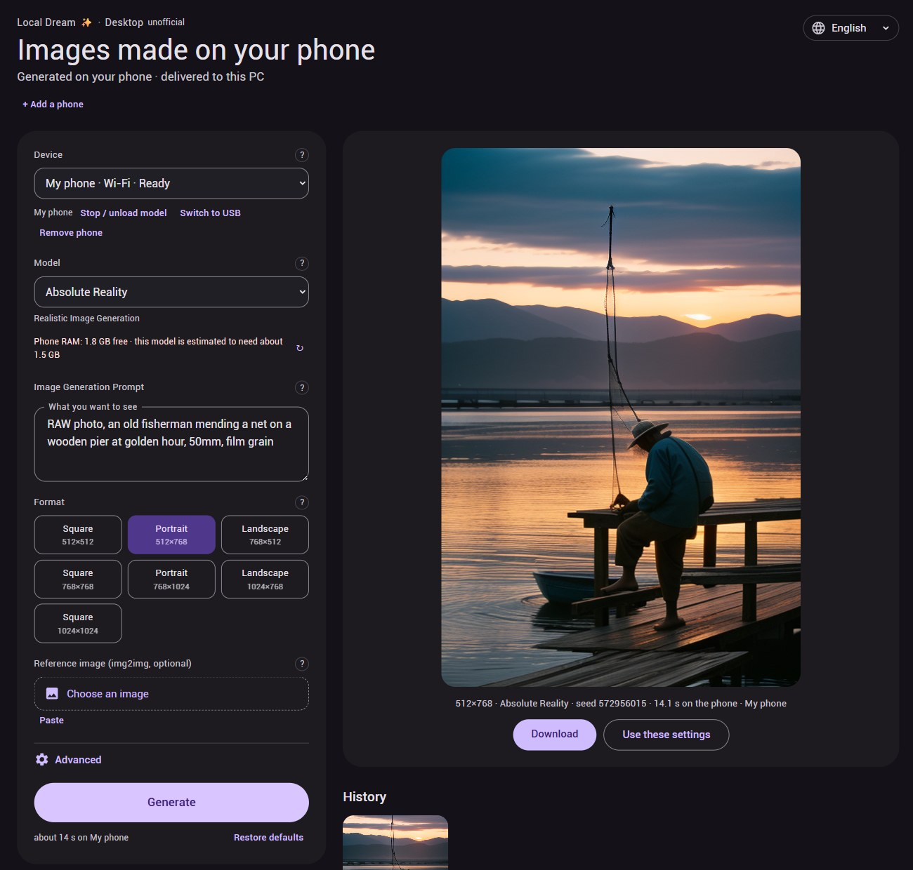

<div align="center">

# Local Dream Desktop 

**Make images on your Android phone, from your desktop**<br>
_Unofficial companion for Local Dream — your phone runs the model, your PC keeps the pictures_

[](https://github.com/augbastos/local-dream-desktop/actions/workflows/ci.yml)
[](https://github.com/augbastos/local-dream-desktop/releases)
[](LICENSE.md)



</div>

## About this Repo

Use Local Dream's host mode from your computer's browser to generate images,
paint masks and save pictures with their settings.
Unofficial companion, not affiliated with [Local Dream](https://github.com/xororz/local-dream).

## Status

Version 0.1.0 is the first public release candidate (see the [changelog](CHANGELOG.md)).

- Tested: official app **3.0.0-alpha.5**, Wi-Fi, text-to-image and SD1.5 NPU inpainting
  with the packaged Windows build.
- Reference editing and DiT masks remain untested with the official app.
- USB, macOS and Linux with a real phone are untested.
- A Linux portable build has automated CI checks only.

## What it does

- Opens a local web page that drives Local Dream's host mode on your phone, over Wi-Fi or USB.
- Text-to-image, image-to-image, an inpainting mask brush and reference editing for compatible models.
- Saves each image as a PNG with a JSON file of its settings.
- Has a console CLI with `--json` output, and an optional assistant skill.

## Requirements

- A Local Dream version with host mode (Device link) and a downloaded model on a
  supported Android phone.
- Wi-Fi works without extra software. USB needs Android Platform-Tools.
- **Windows:** portable download, no Python needed.
- **macOS / Linux:** [run from source](docs/user-guide.md#run-from-source) with Python 3.10+.

> [!WARNING]
> The phone's host-mode ports have **no authentication**: use a trusted network or USB.

## Install

**Windows:**

1. Download the Windows portable ZIP from [Releases](../../releases).
2. Extract the whole folder and keep its files together.
3. Double-click **Local Dream Desktop.exe**. If SmartScreen warns because the app is
   unsigned, choose **More info → Run anyway** only if you trust the download.

**macOS / Linux:** [run from source](docs/user-guide.md#run-from-source):

```sh
python3 -m venv .venv
.venv/bin/python -m pip install -r requirements.txt
sh local-dream-desktop.sh
```

## Use

1. On the phone, open **Local Dream → ⋮ More → Device link → Enter host mode**.
2. In the page, choose **Connect over Wi-Fi**, type the IP shown on the phone and select
   **Connect**; or use [USB](docs/user-guide.md#usb).
3. Pick a model, write a prompt and select **Generate**. Keep host mode running.

Use **Quit Local Dream Desktop** to stop it; images are saved in `~/LocalDreamDesktop`.

For scripts, the CLI supports `--json`:

```sh
python sdgen.py devices --json
python sdgen.py gen "A quiet forest at sunrise" --json
```

In the Windows package, use `ldd.exe --cli devices --json` instead.
The full [user guide](docs/user-guide.md) covers setup, editing, troubleshooting and compatibility.

## Test

```sh
python -m pip install -r requirements-ci.txt
python tools/test_fast.py
node tests/check_page.js
```

The test runner uses up to one process per CPU, keeping each test module isolated.
Use `python tools/test_fast.py --jobs 1` for serial execution. The standard
`python -m unittest discover -s tests` command also remains supported.

CI runs the Python tests and page check on Linux and Windows with Python 3.10
and 3.13. The required checks are `Safety` and `CI passed`. On pull requests,
`Safety` scans for secrets and checks critical paths using the base revision's
policy. `CI passed` requires every test combination to pass and permits a skipped
`Safety` check only outside pull requests.

## Layout

| Path | Contents |
|---|---|
| `local_dream_desktop.py`, `paths.py` | Shared GUI/CLI entry point and path/config handling |
| `studio.py`, `studio.html` | Local web server (127.0.0.1:47865) and the page |
| `sdgen.py` | Phone client and CLI |
| `tests/` | Unit tests and a page check |
| `tools/` | Release build, packaged smoke test, icon and skill installer |
| `packaging/` | PyInstaller spec and [release packaging notes](packaging/README.md) |
| `docs/` | User guide, how it works, engineering notes |
| `assets/`, `vendor/` | Icon and demo image; bundled QR code library |
| `.claude/skills/` | Template for the optional assistant skill |

## Configuration

Copy `local.example.json` to `local.json` next to `sdgen.py`, or set `LDPC_CONFIG` to the
file's path. It sets the image folder (`out`, default `~/LocalDreamDesktop`) and the USB
port base (`usb_port_base`).

## Release

A `v*` tag triggers the Package workflow, which builds the Windows and Linux packages.
Build steps are in [packaging/README.md](packaging/README.md).

## More documentation

- [User guide](docs/user-guide.md)
- [How it works](docs/how-it-works.md)
- [Engineering notes](docs/ENGINEERING.md)
- [Changelog](CHANGELOG.md)

## Credits & Acknowledgments

Thanks to the projects that make this companion possible.

### Built for

- **[Local Dream](https://github.com/xororz/local-dream)** - the Android app that runs
  the models (by xororz, CC BY-NC 4.0).

### Python Libraries

- **[Pillow](https://github.com/python-pillow/Pillow)** - image decoding and PNG saving.
- **[PyInstaller](https://github.com/pyinstaller/pyinstaller)** - portable Windows/Linux
  builds (build-time only).

### JavaScript

- **[qrcode-generator](https://github.com/kazuhikoarase/qrcode-generator)** - QR codes (MIT).

### Tools

- **[Android SDK Platform-Tools](https://developer.android.com/tools/releases/platform-tools)** -
  adb for USB connections.

AI-assisted development: see [Engineering notes](docs/ENGINEERING.md#how-it-was-built).

## License

[PolyForm Noncommercial 1.0.0](LICENSE.md) — source-available, noncommercial,
not OSI open source.

Third-party notices are in `THIRD-PARTY-NOTICES.txt` inside the package
(Python, Pillow and the PyInstaller bootloader exception) and
[vendor/LICENSE-qrcode](vendor/LICENSE-qrcode) (MIT).
