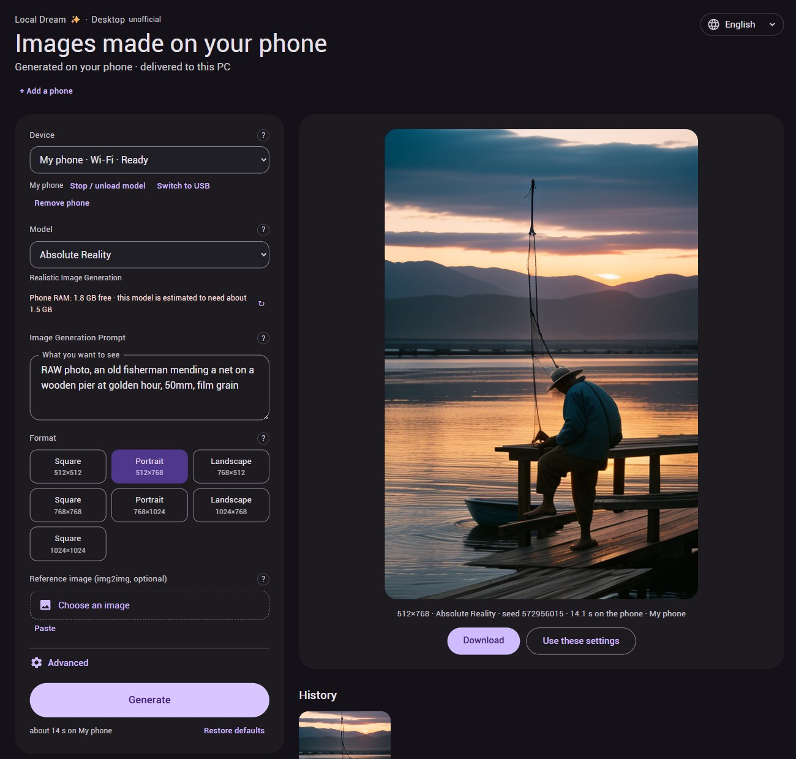

# Local Dream Desktop 

**Make images on your Android phone, from your desktop** 
_Unofficial companion for Local Dream — your phone runs the model, your PC keeps the pictures_

## About this Repo

Use Local Dream's host mode from your computer's browser to generate images,
paint masks and save pictures with their settings.
Unofficial companion, not affiliated with [Local Dream](https://github.com/xororz/local-dream).

> [!NOTE]
> - Needs a Local Dream version with host mode (Device link) and a downloaded model on a
>   supported Android phone.
> - **Windows:** portable download, no Python needed. **macOS / Linux:** [run from source](docs/user-guide.md#run-from-source);
>   a Linux portable build has automated CI checks only.
> - Wi-Fi works without extra software. USB needs Android Platform-Tools.
> - The phone's host-mode ports have **no authentication**: use a trusted network or USB.
> - Tested: official app **3.0.0-alpha.5**, Wi-Fi, text-to-image and SD1.5 NPU inpainting
>   with the packaged Windows build. Reference editing and DiT masks remain untested
>   with the official app; USB, macOS and Linux with a real phone are untested.

## Quick Start

**macOS / Linux:** [Run from source](docs/user-guide.md#run-from-source), then follow
steps 4–6 below. **Windows:**

1. Download the Windows portable ZIP from [Releases](../../releases).
2. Extract the whole folder and keep its files together.
3. Double-click **Local Dream Desktop.exe**. If SmartScreen warns because the app is
   unsigned, choose **More info → Run anyway** only if you trust the download.
4. On the phone, open **Local Dream → ⋮ More → Device link → Enter host mode**.
5. In the page, choose **Connect over Wi-Fi**, type the IP shown on the phone and select
   **Connect**; or use [USB](docs/user-guide.md#usb).
6. Pick a model, write a prompt and select **Generate**. Keep host mode running.

Use **Quit Local Dream Desktop** to stop it; images are saved in `~/LocalDreamDesktop`.

## User Guide

See the [full user guide](docs/user-guide.md) for setup, editing, troubleshooting and compatibility.

Developers: [How it works](docs/how-it-works.md) · [Engineering notes](docs/ENGINEERING.md).

## Credits & Acknowledgments

Thanks to the projects that make this companion possible.

### Built for

- **[Local Dream](https://github.com/xororz/local-dream)** - the Android app that runs
  the models (by xororz, CC BY-NC 4.0).

### Python Libraries

- **[Pillow](https://github.com/python-pillow/Pillow)** - image decoding and PNG saving.
- **[PyInstaller](https://github.com/pyinstaller/pyinstaller)** - portable Windows/Linux
  builds (build-time only).

### JavaScript

- **[qrcode-generator](https://github.com/kazuhikoarase/qrcode-generator)** - QR codes (MIT).

### Tools

- **[Android SDK Platform-Tools](https://developer.android.com/tools/releases/platform-tools)** -
  adb for USB connections.

AI-assisted development: see [Engineering notes](docs/ENGINEERING.md#how-it-was-built).

## License

[PolyForm Noncommercial 1.0.0](LICENSE.md) — source-available, noncommercial,
not OSI open source.

Third-party notices are in `THIRD-PARTY-NOTICES.txt` inside the package
(Python, Pillow and the PyInstaller bootloader exception) and
[vendor/LICENSE-qrcode](vendor/LICENSE-qrcode) (MIT).
